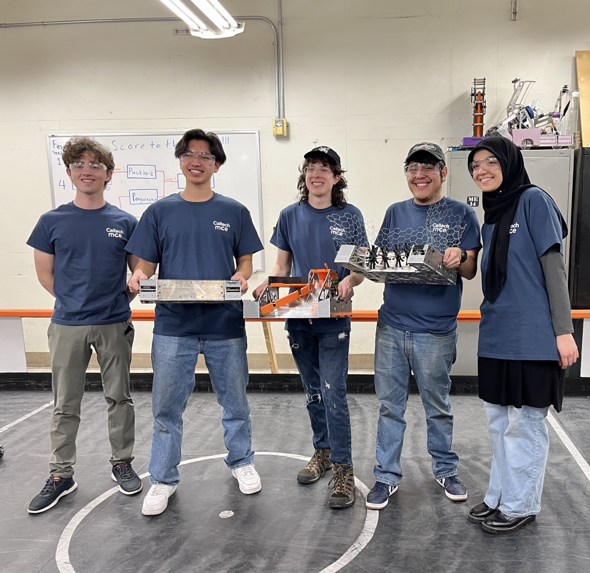

## Academic and Professional Projects
### Caltech ME 72 Senior Design Capstone (September 2024 - March 2025) 

#### Introduction

Teleoperated robots let people work in places that are too dangerous, remote, or cramped to enter themselves, from disaster response to hazardous-material handling. Building them well takes more than a good chassis: the machine, its electronics, and its operator interface all have to work together under stress. For my Caltech Mechanical Engineering Senior Capstone, my team had six months to design and build three teleoperated robots that could compete in robot hockey in a magnetized arena. The goal was to build robots fast, durable, and powerful enough to win the puck and overpower opponents, while working within a strict budget and an industry-style process: Bills of Materials (BOMs), a Preliminary and Critical Design Review (PDR and CDR), demonstration deadlines, and a maintained engineering notebook.

#### My Role

I was my team’s software and electronics lead and a key contributor to mechanical design and fabrication. I solely wrote the driving code and remote control interface, and I selected, designed, and assembled all of the robots’ mechatronics. I also led 3D printing for the team, CADing and designing key mechanical components for manufacturing. I made key decisions between TPU, PLA, and PET-G to balance flexibility, impact resistance, and rigidity. The code is on my [Github](https://github.com/julian-millan).

#### Design

Our robots had to apply high torque to push opponents while staying controllable and within budget, so I treated the electronics and software as a single system.

Mechatronics: Our drivetrain needed high torque to overpower other robots, which forced a trade-off among budget, motor selection, and motor controllers. I selected 12V redline motors driven by 2x60A and 2x46A RoboClaw motor controllers, chosen because they could handle the current and heat the motors drew per robot. I assembled the electronics to withstand impact and shock using redundant adhesives, precise mounting, and designing solid carriages to hold our most important components.
Software and controls: I wrote the driving code in C++ on an Arduino, with a remote interface that mapped controller inputs to driving and shooting. I designed it around three priorities: user-friendliness, speed, and fit with each driver’s preferences. I tuned the control mappings through user testing, using a mathematical function to point joystick direction to robot speed and direction.

#### Evaluation

We won second place in the class-wide [competition](https://www.youtube.com/live/KheHtUqBbpU?si=4mcJCXxG_Whs3pPR). Analyzing our performance:

Driving and control: Drivers were comfortable with the control scheme, and maneuvering our robots quickly around the opponent was a team strength during the competition.
Durability: The electronics survived six five minute matches of impacts and sustained high-torque loads without mechanical failure, ensuring all three robots were driveable until the end of the competition.
Mechanical performance: The design pushed opponents effectively, though the attacking robot lacked shooting ability.

If I did the project again, I would spend more time examining mechanical points of failure in our shooting mechanism on our attacking robot.

#### Conclusion

This project taught me how to design hardware and embedded software together under real constraints, and how much a driver’s experience depends on small decisions in the code. 

### Caltech ME/CDS 234a Final Project (March 2025)
This was a shorter solo project, where I examined rescue robotics in simulation within the context of robotic planning. I employed skills in RRT, Kalman Filtering, Python, and general motion planning. I was able to successfully design a robotic planner that could be robust against a variety of environments and "signal interference". A video demonstration can be found [here](https://youtu.be/v9ArnxscL8A?si=ZjikmbmaAAM8VT9u).

### Caltech ME/CS/EE 169 Final Project (April - June 2024)
This project involved designing a fully autonomous car capable of solving a known and unknown maze. I led both the robot fabrication and the design the full software stack. I utilized skills in SLAM, low level mobile robotics programming, collision avoidance and dynamic robotic planning. A project demonstration video can be found [here](https://youtu.be/JR84L-bYDIU).

### Caltech ME/EE/CS 134 Final Project (January - March 2024) 
This group project, we were given the task to design a 7-DOF arm for a complex task with recovery modes. I was the mechanical design lead and a key contributor to the programming of the recovery modes. As the mechanical lead, the design and fabrication was my primary responsibility, and I utilized skills in 3D printing, inverse kinematics, 3D CAD, machining, and beam bending analysis. 

This led to a successful creation of the robot, that was able to interact with other game players and employ various recovery behaviors in both typical gameplay scenarios and scenarios involving unexpected behaviors from other players. The demo video can be found [here](https://youtu.be/ghnqkQhqNAI) and more details on the work done can be found in our <a href="/assets/ME134_Final_Report (1).pdf" class="btn" target="_blank">final report (PDF)</a>.

### Caltech ME/CS/EE 133b Final Project (March 2024) 
This was a shorter (about three weeks long) project at the end of my undergraduate robotic planning class. I worked in a trio on testing various planning algorithms in a 2D maze. In particular, we tested conventional RRT and EST planning algorithms against modified RRT and EST planners adapted to go 90 degrees significantly more often than usual. A wrinkle we added was the existence of "locked doors", requiring our planner to acquire the right keys before proceeding.

I worked primarily on the development of the RRT and EST 90 degree planners. A video of our findings can be found [here](https://youtu.be/bAizg2_v2O0) and more details on each of the algorithms can be found in our <a href="/assets/CS 133b Final Project Report.pdf" class="btn" target="_blank">final report (PDF)</a>.

### Caltech ME/CS/EE 133a Final Project (December 2023)
This was another shorter partner project that looked to apply fundamental robotic kinematics and ROS2 knowledge in a creative direction using a known pre-made robot model. This was a relatively simple and lighthearted project meant to showcase our skills in the fundamental aspects of robotics. I applied skills in Linux, ROS2, Python, robot kinematics, and more. A video of the virtual demonstration can be found [here](https://youtu.be/MOWTQnGmksY). More information about the project can be found in the <a href="/assets/ME_CS 133a Final Report.pdf" class="btn" target="_blank">final report (PDF)</a>.
